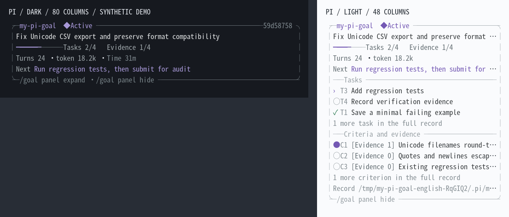

# my-pi-goal

English | [简体中文](README.zh-CN.md)

A personal Pi extension for durable goals: clarify complex requirements, continue authorized work, save evidence, run checks, and obtain an independent audit before declaring completion. Supports complex repairs, research analysis, building projects, and a sequential goal queue.

The [model prompts](docs/prompts.md) inject one current execution policy per eligible request and rebuild goal state after compaction.

The interface, commands, tool messages, examples and supporting documentation use English. User objectives, evidence and historical records keep their original language. Offline behavior tests and real Pi SDK integration tests are available; continuous 5–12 hour runs with a real model, non-Linux platforms have not yet been validated. Host support is limited to the current and immediately preceding Pi releases.

## Get started

For this local installation, run `/reload` in an existing Pi session. To install the private source package globally:

```sh
pi install /absolute/path/to/my-pi-tools/goal
```

Or load it temporarily:

```sh
cd /path/to/project
pi -e /absolute/path/to/my-pi-tools/goal/extensions/index.ts
```

The package is private and is not published to npm. Avoid registering it both globally and in project settings.

```text
/goal Fix CSV export for Unicode filenames and verify existing format compatibility
/goal
/goal approve
/goal add Document the export fix
/goal pause
/goal resume
/goal clear
```

The model first inspects the workspace and proposes an objective, acceptance criteria, tasks and check commands. Short, simple goals can accept their initial scope automatically. Longer goals, research, new projects, migrations and publication require approval. Classification is a heuristic; the legacy `/goal start <objective>` still permits explicit initial fast start, with criteria and independent verification still required.

You can also ask in ordinary conversation: “Use a goal to fix the export bug and keep working until verified.” The model can call `goal_create`, then `goal_plan`, without requiring you to type a creation command. It can use `goal_resume` when you ask to continue approved stopped work. Initial classification and independent verification are the same as the command workflow.

Send additional requirements as ordinary messages. The plugin records them, cancels stale audits and supplies the current goal to subsequent requests. `goal_plan` can propose modifications while active, paused or blocked. **Every modification to an approved specification requires your `/goal approve`, including task additions/reordering.** Until approval, the accepted specification and evidence remain intact; approved task refinements retain existing task IDs and evidence. Identical specifications are a no-op. See [model lifecycle tools](docs/model-goals.md).

## Everyday commands

| Command | Behavior |
| --- | --- |
| `/goal` | Show this session's goals, queue, IDs, revisions and proposed scope |
| `/goal <objective>` | Create a goal and plan automatically |
| `/goal add <objective>` | Append a queue draft and request a proposal; does not approve it |
| `/goal approve [id]` | Review the readable proposed scope and approve it |
| `/goal pause` | Stop the current goal and queue, preserving progress |
| `/goal resume [id]` | Acquire ownership automatically and continue; select the approved queue head if the previous goal ended |
| `/goal clear` | Clear this session's goals and queue, cancel work, and close the panel; retain journal history |

`/goal help` shows these commands. Planning and amendments normally use conversation, so `plan/amend` need not be memorized. Ownership is automatic: operations acquire it, and idle pauses, waits, completion and session shutdown release it. If another Pi instance is still executing the same session, concurrent writes are rejected. Different sessions have independent goal journals.

Use `/goal help more` for occasional controls:

| Control | Behavior |
| --- | --- |
| `/goal panel [show\|hide\|compact\|expand]` | Control visibility or detail; no argument toggles visibility |
| `/goal skip [id]` | Explicitly skip a goal without a second confirmation; preserve history, then use resume |
| `/goal budget 100k` or `/goal budget none` | Set or remove the cumulative token budget; unlimited by default |
| `/goal model provider/id` or `/goal model inherit` | Override the audit model or restore configured/inherited selection |
| `/goal permissions [autonomous\|confirm]` | Show or change the execution policy |
| `/goal settings` | Show effective defaults and configuration paths |
| `/goal approve-exact <id> <revision>` | Non-interactive approval of a specific, previously reviewed proposal |

The approval screen groups the objective, kind, acceptance criteria, tasks, checks and execution permissions into labeled sections. In the terminal, use ↑/↓, PgUp/PgDn or Home/End to review long scopes; Enter approves and Esc cancels (configured confirm/cancel bindings are respected). Text is wrapped for the available width without truncating the proposal. RPC receives the same readable summary through its standard confirmation dialog.

IDs accept unique prefixes. An unapproved draft at the queue head prevents automatic advancement past it. `status/list` remain aliases for `/goal`; `start`, `plan`, `amend` and `remove` remain compatibility commands. `take-over/release` are retired and only explain the automatic behavior. Commands use English; localized command aliases have been removed.

## Execution and verification

1. Agree on the objective, criteria, tasks and checks.
2. Execute through normal Pi tools and record evidence and next steps with `goal_progress`.
3. Request native continuation at `agent_before_settle`, yielding to queued user input. Cancellation and errors do not silently restart work.
4. Run each approved check with `goal_check` in the main session; it records the actual tool result.
5. `goal_submit` starts a fresh read-only reviewer. It can request information with `audit_request`; the main session answers with `goal_reply` and resubmits.
6. A failed audit returns concrete repair feedback. Only an accepted current result completes the goal and advances the approved queue.

The executor cannot set `complete`. The auditor must actually inspect artifacts and see the tool results in a later model response before submitting a verdict; a prewritten read-and-pass batch is rejected. Executor evidence is a claim, not independent inspection. Models can still misjudge evidence; explicit findings and deterministic checks make decisions reviewable.

### Main-session execution and read-only review

All file changes, commands and dependency installation belong to the main session. `goal_check` delegates approved commands to its normal bash tool and permissions; `goal_submit` runs no commands. Temporary reviewers have explicit read-only tools and no inherited extensions or MCP. No Docker profile or subagent package is required.

A reviewer can yield `needs_info` with a request ID, question and criterion. The main session supplies concrete information through `goal_reply`, runs any required approved check, then resubmits. Requests do not spend repair attempts and answers never count as an audit pass. Current-generation answers persist across reload.

Fresh check receipts and unchanged reviewed artifacts are required for completion. See [execution, review and migration](docs/read-only-review.md) for source-marker exclusions, the application-level capability boundary and legacy settings.

### Storage and context efficiency

Journal commits store compact deltas with a full snapshot every 25 revisions, and the store reuses its parsed snapshot while the journal file is unchanged. Long goals therefore avoid re-reading and re-validating their entire history on every tool call, while external writes and tampering still force a verified re-read. Executor context and the default `goal_status` view keep evidence as counts and previews; `goal_evidence` pages exact records on demand. Historical journal bytes stay append-only and `STATUS.md` remains a derived export.

## Panel

The compact card uses the current Pi theme and shows the objective, task progress, evidence coverage, turns, tokens and next step. Wide terminals also show elapsed active time; unknown usage is identified. Evidence coverage does not mean an audit passed. Proposed scope displays its own tasks and criteria rather than reusing the prior specification's progress.

`/goal panel` toggles visibility. `panel expand/compact` changes detail and `panel show/hide` explicitly controls visibility. Hiding the card does not pause work; the status bar remains. Expanded sections show at most three items and prioritize active tasks; shorter terminals reduce detail. Narrow terminals use a borderless summary or a single line, with terminal-width-aware truncation.

After a goal passes independent verification, its Verified result stays visible until you send the next ordinary message (interactive or RPC). If no unfinished goals remain in the session, that message automatically clears the finished state and hides the panel/status. The message is processed normally; cleanup does not cancel it or start an extra model turn. If the final reply is still streaming, cleanup waits for that turn’s usage to be recorded. Journal history and artifacts remain. Extension-generated input and failed/skipped goals alone do not trigger cleanup; an unfinished queue is preserved. Commands such as `/goal` still let you inspect the result before sending a message.

Goals, queues and panel preferences are isolated by Pi session ID. A new, forked or cloned session does not inherit another session's goals or preference. Returning to the original session restores its records. `clear` removes both card and status bar and records a durable cancellation marker. Every subsequent model request receives the current empty state, including after reload or compaction. Old goal IDs return a non-mutating stale-goal explanation. Clearing never schedules a model turn or authorizes recreating cancelled work; a new user request may create another goal and show the card again.



The preview uses synthetic goals and the real panel renderer; it is not evidence of a completed user project.

## Budgets and automatic pauses

Only repair attempts, no-progress protection and an optional cumulative goal token budget remain:

- No plugin execution turn or time cap. Turns and active time are statistics. Resume resets current-run and consecutive-failure/stagnation counters while preserving cumulative usage, history and evidence. Model `goal_resume` cannot undo a stop until a later user message arrives, bypass pending approval or an exhausted token budget, or reset counters on an already active goal. `/goal resume` remains the explicit user override for eligible stopped work.
- Tokens are unlimited by default. A configured budget includes available execution, nested-tool, audit and stagnation-review usage, including repeated inputs and cache reads. Reasoning tokens are not added twice.
- Usage is known after a response finishes, so the final request can overshoot. This is not a hard monetary limit. Missing usage is marked unknown.
- After an initial failed audit, allow up to three automatic repairs; pause after the fourth consecutive failure. Cumulative-budget errors do not consume repair attempts. Change the budget and resume without weakening criteria or resetting evidence.
- After three turns without progress, request a different strategy. After five, save an independent diagnosis and pause. If diagnosis is unavailable, still pause. New evidence, task changes and distinct successful tool results count as progress; repeated identical results do not. This is a heuristic, not a proof of semantic progress.
- No separate audit turn, token, time or response-output cap; no diagnostic deadline or output cap. Only an explicitly configured cumulative budget constrains these operations. Native host/provider limits still apply.
- Approved checks need only a `command`. Sandbox resource limits, including provision/check/cleanup deadlines, are configured in the personal profile; the default check deadline is 120 seconds. Pause or cancellation removes the disposable VM. These limits are separate from the overall goal and auditor budgets.
- Evidence and long output are retrieved by ID with pagination. Full objectives, criteria, tasks and supplements remain in the audit contract. File, pagination and journal resource boundaries are not execution budgets.

## Permissions and read-only checks

The default policy is **autonomous**. After scope approval, Goal adds no per-tool approval prompts for authorized project edits, testing, research, dependency installation, temporary-file cleanup or existing external tools. Normal implementation choices are not reasons to ask whether to continue.

Autonomy does not override Pi, other extensions, operating-system restrictions, explicit network/install policies or the agreed task scope. Missing required data, credentials, unresolved external blockers, material scope changes, budget exhaustion and repeated audit failures can still pause execution. Scope authorization is not inferred from shell keywords.

`/goal permissions confirm` enables additional cooperative checks for writes outside the project, installation, network access, commits/publication, remote/destructive commands and external tools. Exact grants are reused within the goal. Rejection or unavailable UI pauses work; approval dialogs have no plugin timeout. This is not a sandbox for arbitrary scripts.

Policies are saved with each goal. Legacy goals without a policy inherit configuration until approval/resume saves it. To recover a goal paused by an older restrictive policy:

```text
/reload
/goal permissions autonomous
/goal resume
```

Explicit `network: "ask"` and `install: "ask"` settings are respected. The command above explicitly switches both to allow for that goal. Unapproved scope still requires approval.

The reviewer has only `audit_read`, `audit_search`, `audit_list`, `audit_record`, `audit_request` and `audit_result`. Evidence records and answers do not count as independent inspection. Paths must resolve inside the project; text files are limited to 5 MB. A later response must review actual artifact results before a verdict.

**Checks execute through the main session.** Its existing tool permissions and environment apply, and writes remain in the project. The reviewer cannot run commands. Old `sandbox` settings are ignored; unfinished goals must rerun approved checks through `goal_check`. [Boundary and migration](docs/read-only-review.md).

## Configuration

Defaults merge personal `${agentDir}/my-pi-goal.json` and project `.pi/my-pi-goal.json`, in that order. Files are not created automatically. Reload after editing defaults. Existing goals retain saved limits and policies; use budget/permissions to change them explicitly.

```json
{
  "limits": { "maxTokens": null, "maxAuditFailures": 3, "noProgressWarn": 3, "noProgressPause": 5 },
  "audit": {},
  "permissions": { "mode": "autonomous", "network": "allow", "install": "allow" }
}
```

Selecting only `confirm` defaults network/install to ask; selecting only `autonomous` defaults both to allow. Explicit action policies take precedence. Audit selection can specify `provider`, `model` and optional `thinking` (`minimal/low/medium/high/xhigh/max`); otherwise it inherits the current model and thinking level through Pi's public registry. Credentials are not copied into journals.

Retired `limits.maxTurns/maxSeconds`, `audit.maxTurns/maxTokens/timeoutSeconds` and `checks[].timeoutSeconds` fields are ignored. The complete original hash chain is checked before normalizing the live snapshot. New writes append; historical evidence is not rewritten. `/goal limits` only reports its retirement.

## Persistence and recovery

The authoritative journal is `.pi/my-pi-goal/sessions/<SHA-256(sessionId)>/state.jsonl`. The hash key supports custom SDK session IDs without path traversal. Entries contain snapshots or incremental patches, session IDs, revisions and a hash chain, flushed on commit. The neighboring `STATUS.md` is a readable derived report. `goal_status` returns the full journal path. Project configuration remains shared at `.pi/my-pi-goal.json`.

Pi stores revision references and panel preferences in the session. `/tree` pauses execution without rewinding durable goal history or workspace files. Instances of the same session use a single writer, with a new ownership token on each acquisition. Old store, token, goal-ID or generation callbacks cannot apply results. Release waits for final usage accounting and queue advancement. Separate sessions still work on the same project files; journal isolation does not coordinate their code edits.

Legacy `.pi/my-pi-goal/state.jsonl` remains untouched. When a session containing old plugin references resumes for the first time, the plugin validates the full journal and imports it only if its last owning session ID matches. A live old writer blocks import. Existing session journals, including empty snapshots after clear, are never imported again. Previously shared history belongs as a whole to its last owner; it is not heuristically split across sessions.

Exit, reload and session replacement preserve state without automatically executing. Use resume. Normal shutdown checkpoints time; crash recovery excludes offline time and may lose activity since the last checkpoint. An interrupted final line is preserved separately before the next append; corruption in the middle refuses writes. If a crash leaves an empty `transaction.lock`, verify its process has stopped before removing it. Do not edit journals by hand.

Long runs require Pi to stay alive, for example in tmux. There is no daemon, automatic model switching or subagent orchestration. Dedicated SSH/browser/MCP adapters, notifications and parallel agents are future work.

## Research goals

Research scope adds requirements for a Markdown report, output manifest, provenance and reproducible commands/scripts. Explain inapplicable items and missing inputs; never fabricate data or citations. Domain experts and appropriate methods remain necessary to assess scientific validity. Exact legacy built-in criteria are recognized without translating or duplicating already approved obligations.

[Example specifications](examples/goal-specs.json) are synthetic scenarios, not completed analyses of user data.

## Development and compatibility

```sh
npm ci --ignore-scripts --legacy-peer-deps
npm run dev:link-host
npm run check
npm test
npm run check:format
npm run check:load
npm run verify:setup
npm run check:compat
npm run verify:coverage
npm run verify:formal
npm run verify:evidence
```

Pi packages are host-provided peer dependencies. `dev:link-host` locates the managed installation matching `pi --version`; pass a host `node_modules` directory for another layout. Rerun it after upgrading Pi. It refreshes obsolete symlinks without replacing manually installed dependency directories.

Only the **current Pi release and the immediately preceding release** are supported: currently **1.4.0 and 1.3.0**. Exact peer ranges and the extension entry guard enforce this rolling window. `npm run check:compat` runs types, the full suite and extension loading for both versions in temporary checkouts without changing workspace links or user settings. `check:load` inspects real extension registration and rejects mismatched CLI/workspace versions; a model-listing command alone is not a load check. See the [support policy and upgrade procedure](docs/compatibility/support-window.md), [1.4.0 review](docs/compatibility/pi-1.4.0.md), [1.3.0 review](docs/compatibility/pi-1.3.0.md), [historical 1.2.0 review](docs/compatibility/pi-1.2.0.md) and [historical 1.1.0 terminal checks](docs/compatibility/pi-1.1.0.md). Older host releases need no ongoing compatibility shims; saved goal data remains protected. Tests use offline fixtures, not paid APIs or user data.

TLA+/TLC finite-state checks cover thirteen protocol models, including permissions, accounting, recovery, context projection, inspection, cancellation and scheduling. Direct bounded enumeration also checks implementation contracts. The [coverage inventory](verification/COVERAGE.md) maps production modules and records exclusions; its consistency check rejects unlisted modules/models. Positive properties and deliberately broken controls have reproducible receipts. A historical FIFO bug was found and fixed. Read the [method and mappings](verification/README.md) and [report](verification/REPORT.md) for finite bounds, assumptions and limits; these do not prove LLM correctness, physical crash durability or termination of arbitrary long runs, and add no product budgets.

Further reading: [requirements](docs/requirements.md), [design](docs/design.md), [package research](docs/research.md), [source metadata](docs/sources.json), and the [real TeamAgents recovery incident](docs/incidents/2026-10-07-teamagents-audit.md). The recovery was a short real-model validation, not a completed long-duration test.
