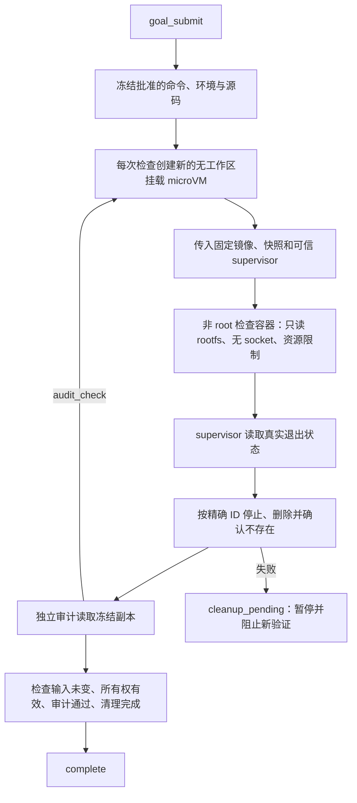
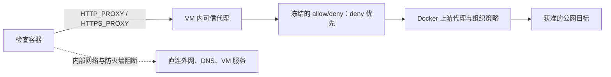

# Goal 的 Docker Sandboxes 验证架构

当前实现使用独立 `sbx` CLI 创建本地 microVM，已完全移除 bubblewrap 执行器。主 Pi、状态与审批记录、审计模型请求留在宿主；已批准的检查与 `audit_check` 在验证沙箱内运行。配置见 [setup](docker-sandboxes-setup.md)，实际通过的测试与限制见 [验收记录](docker-sandboxes-acceptance.md)。

## 执行路径

外层 microVM 隔离宿主，内层检查容器约束 VM 内的项目命令。trusted shell 模板通常拥有 root/sudo 和 Docker 集成能力，因此不能只靠 chmod 将整个 VM 宣称为只读。检查容器由 supervisor 创建，固定 UID 1000、丢弃 capabilities、启用 `no-new-privileges`、不传 Docker/SSH socket，覆写 ENTRYPOINT 并清空环境。

宿主只复制声明范围内的源码字节，包含 dirty/untracked 内容；不挂载真实工作区、home 或宿主 socket。每次检查都使用独立 VM 与独立卷，检查间的构建依赖应写成一个批准的复合命令。

## 灵活联网

- `isolated`：创建 VM 时设置 `--deny-network '**'`，检查容器使用 `--network none`。
- `allowlist`：仅允许 `allow` 中的 DNS 目标及端口，排除 `deny`。
- `open`：允许公共 DNS 目标，仍应用 `deny` 与 Docker 的上游限制。
- 目标支持精确域名、`*.example.com` 子域模式和可选端口。重定向和 CDN 需要另列目标。
- 检查必须使用代理；其内部 Docker 网络不能直达外网，VM INPUT 防火墙只开放该代理端口。容器 DNS 被指向回环以阻止直接外部查询。
- 代理拒绝原始 IP、私有 IPv4 和保留集成主机名。当前不支持 IPv6 出站、私有网段服务、宿主回环服务或通用原始 TCP/UDP；支持代理的客户端可通过 CONNECT 到获准端口。
- 上游会再次解析 DNS；其 DNS 与私网访问限制仍是信任边界的一部分。

只修改新建 VM 的网络规则。创建时先拒绝全部流量，按精确规则 ID 删除启动阻断规则；open 模式因 sbx 不允许相反的同名通配规则，先删除 gate 再加 allow-all。所有策略设置均发生在项目代码运行前。即使全局允许规则较宽，内层代理仍检查 goal 的策略；组织拒绝规则不会被放宽。插件从不 reset 全局策略。

网络调整沿用 goal 的 `network: ask|allow` 权限策略。确认许可绑定 goal ID、网络模式与规范化的允许/拒绝列表；扩大目标或改成 open 不能复用旧许可。与网络无关的工作区调整可复用原网络许可。批准的命令与验收标准不变，因此不需要重新 `/goal approve`。

## 输入、证据与完成门禁

`source-v1` 快照过滤已知凭据路径及依赖/缓存目录；不解释 `.gitignore`，不执行 Git hooks 或 filters，并拒绝符号链接、硬链接和特殊文件。它不是通用秘密识别器。个人配置选择镜像与宿主可执行程序，项目配置不能覆盖这些字段。

每次 attempt 绑定 `snapshotDigest + environmentDigest + specDigest`。初始检查与审计复跑使用同一份输入；`audit_read/search/list` 读取宿主冻结副本。完成前再次扫描当前选定源码并检查 session/owner/generation fence。输入变化、异步所有权失效、检查失败或未完成清理都不能提交成功。

项目 stdout 只是输出。可信 supervisor 独立读取内层容器退出状态并编码结果；检查无法直接向宿主伪造成功响应。失败复跑被 pipeline 锁存，审计的 pass 不能覆盖它。

## 取消、恢复与资源边界

取消先终止本地 CLI 进程组，再用独立清理信号停止、删除并确认 VM 消失。创建前持久化意图，取得真实资源 ID 后才允许自动删除；不凭名称前缀清理。失去业务 fence 的旧回调仍清理自己拥有的资源。

独立 watchdog 在父进程退出或总期限到达时尝试回收 VM。无法回收会保留 `cleanup_pending`，立即暂停当前目标并阻止新验证。`/goal sandbox cleanup` 对精确 ID 做恢复；创建响应丢失且没有记录 ID 时需要人工核对。

个人配置控制 CPU、内存、进程数、输出、源码大小，以及创建/执行/清理期限。默认检查期限 120 秒，可按任务需要调整；它与 goal 整体 token 预算和审计模型预算分开。

## 迁移与待扩展范围

没有 fallback 后端；配置缺失或 sbx 不可用即拒绝验证。旧 `network: host` 迁移为离线，旧环境变量转发列表需清空，再显式配置新网络策略。历史日志和审计记录保留。

当前真实平台证据只适用于 [验收记录](docker-sandboxes-acceptance.md) 中的版本与案例。单元测试和形式化模型分别证明有限的实现行为与抽象协议性质，不能代替内核隔离证明。当前未覆盖所有平台、恶意内核漏洞、任意 daemon 崩溃、watchdog 被杀、恶意宿主并发改写、PID 复用、宿主磁盘配额和持久化产物导出。

后续独立能力包括：可配置输入 profiles、持久化 manifest/产物、显式非秘密环境值、私有网络服务、更多工具链镜像与将整个 Pi worker 放进独立 VM。当前实现只隔离验证路径。

## 官方参考

- [Docker Sandboxes architecture](https://docs.docker.com/ai/sandboxes/architecture/)
- [Installation](https://docs.docker.com/ai/sandboxes/install/)
- [Isolation](https://docs.docker.com/ai/sandboxes/security/isolation/)
- [Local network policy](https://docs.docker.com/ai/sandboxes/governance/access-controls/local/)
- [CLI](https://docs.docker.com/reference/cli/sbx/)
