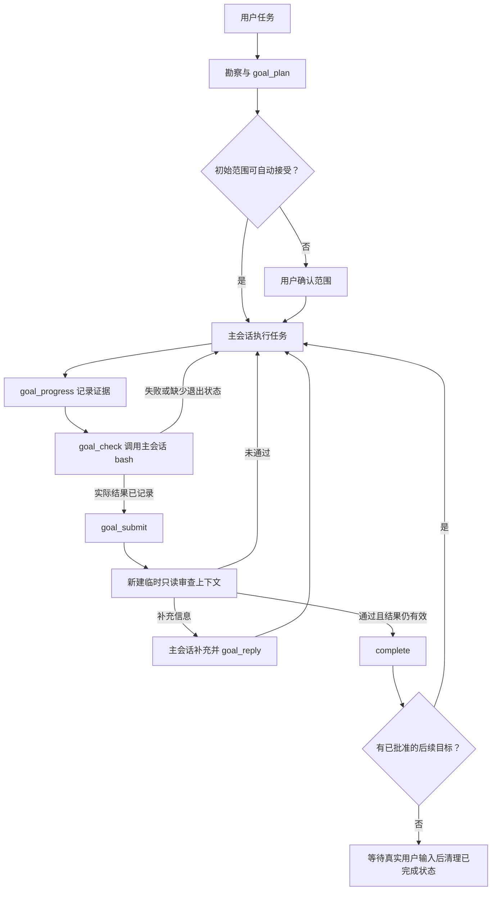
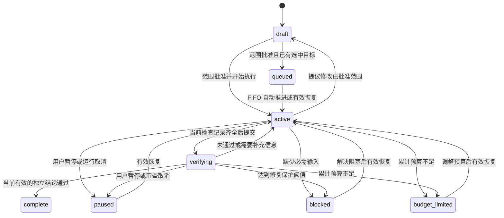
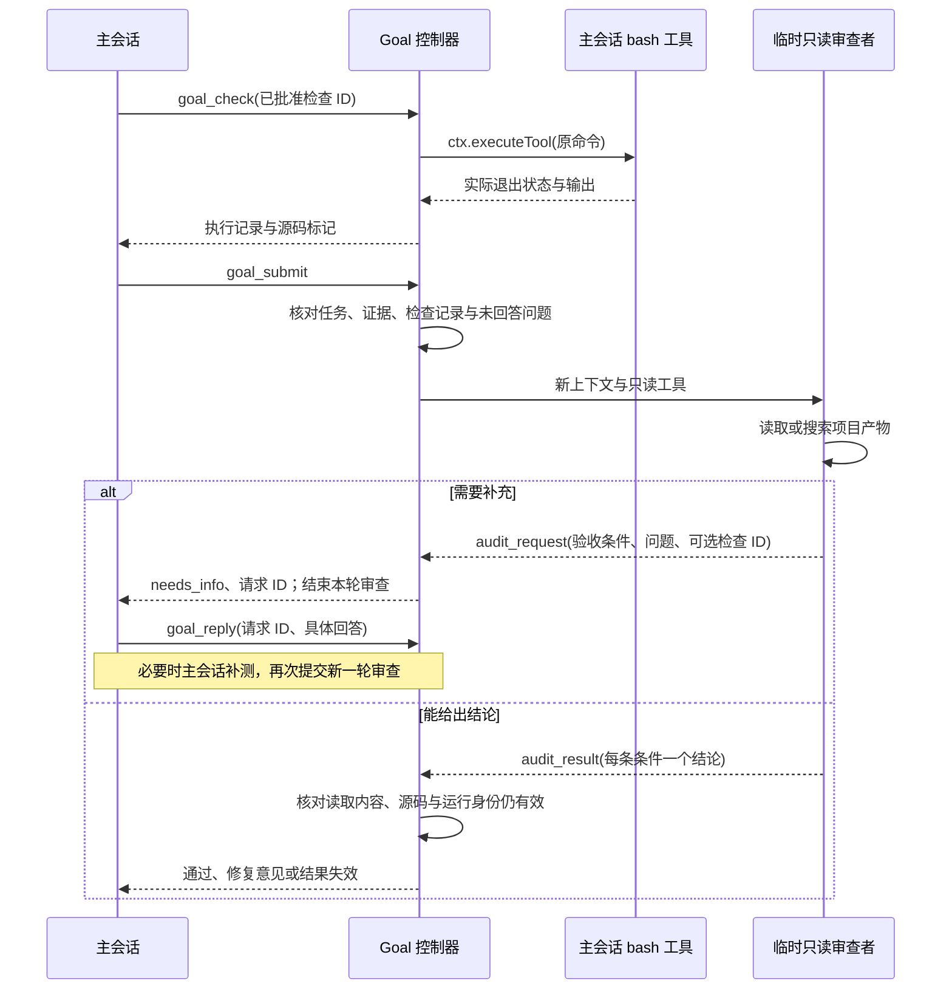

# Goal 流程

Goal 负责范围、进度、执行记录和独立审查。主会话负责写文件和执行命令，临时只读审查者负责读取产物、提出问题和提交结论。实现边界见[执行与只读审查](read-only-review.md)。

## 入口与执行

检查命令由主会话显式调用；`goal_submit` 和审查者不执行命令。未配置检查的目标可以直接提交审查，但仍需逐条证据、完成任务和真实产物检查。

## 状态与失效

会话、目标、generation、所有权或范围变化会使旧回调失效。已发生的审查用量在仍具备原记录写入权时保留；过期结论不能用于完成替代目标。暂停、预算与明确停止规则不因补充信息请求而放宽。

## 审查与补充信息

回答是执行器证据，不能替代独立读取或直接使目标完成。补充请求不计入修复失败次数。主会话不会在等待审查返回的同时被要求回复，避免相互等待；下一轮使用新审查上下文并读取已保存的回答。
