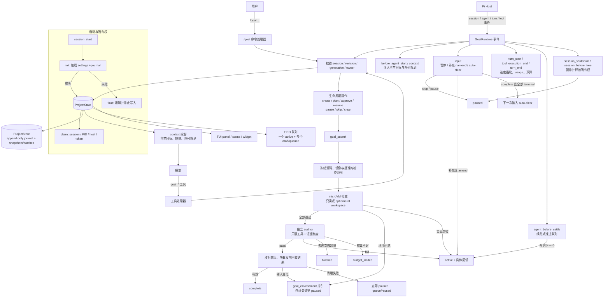
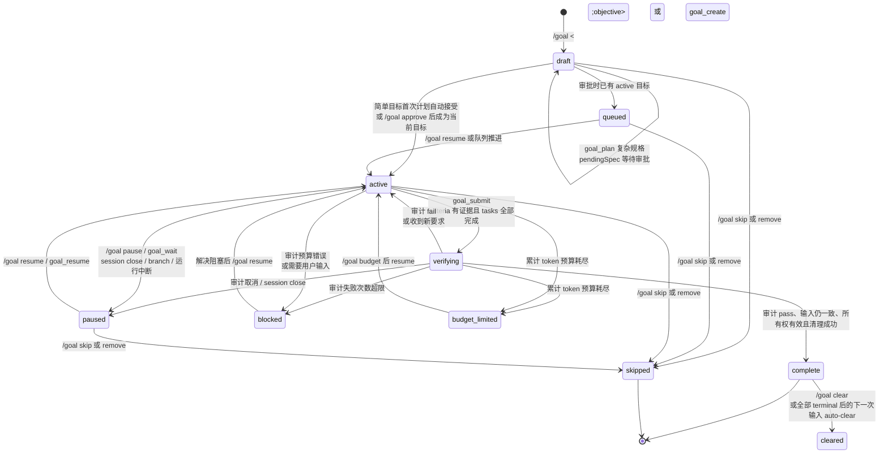
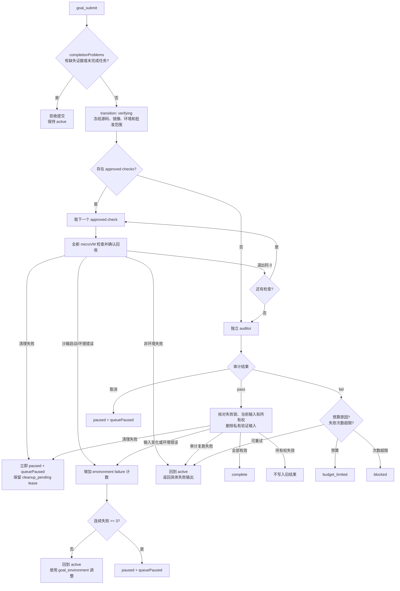

# `my-pi-goal` 流程图

> 本页展示业务状态与事件流。验证路径已切换到 Docker Sandboxes；快照、联网和回收细节见 [验证架构](docker-sandboxes-design.md)。

以下按当前 `GoalRuntime`、状态机、验证链路和持久化实现绘制。图中把 `ProjectState` 作为单一业务状态源，Journal、上下文投影和 TUI 都是它的派生视图。

## 1. 运行时与事件流

## 2. Goal 状态机

> `cleared` 不是 `GoalStatus`：它会从当前 session 的 `ProjectState` 移除目标，但 journal 保留历史。`queuePaused`、`activeId`、`owner` 和 `pendingSpec` 是与 `status` 正交的运行时字段。

## 3. `goal_submit` 验证链路

## 读图后的优化方向

1. **`draft` 语义过载**：初始草稿和“等待 scope 审批”都用 `draft`，实际差异藏在 `pendingSpec`、`approved` 和 `directStart` 中。可以拆成显式的 `planning` 与 `awaiting_approval` 状态。
2. **状态维度过多**：`status`、`approved`、`pendingSpec`、`directStart`、`queuePaused`、`activeId`、`owner` 共同决定行为，容易产生隐藏状态。建议集中定义转移表，并为关键不变量写断言。
3. **派生视图重复**：journal、内存 `ProjectState`、context 消息和 TUI widget 各自投影。建议明确“状态源 → 投影”的边界，避免四处修补同一状态。
4. **提交流程分支复杂**：已提取 `VerificationContext` 管理冻结输入、检查复跑、失败锁和销毁；`goal_submit` 仍组合审计、预算、取消和状态写入。后续可继续集中终止原因，减少重复的清理与错误分支。
5. **事件重入与 fencing**：`before_agent_start`、`input`、`turn_end`、`agent_before_settle` 都可能写入状态。可考虑用单一串行化 reducer/actor 统一处理，降低 generation/owner 校验的分散程度。
